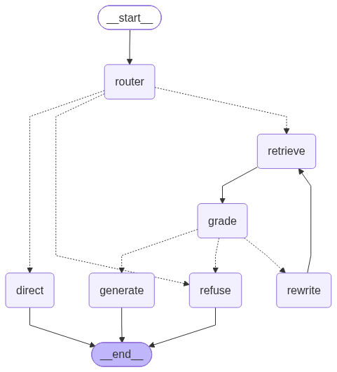
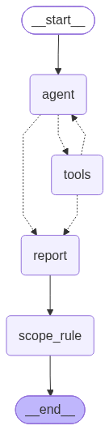

# rag-demo：从 RAG 链到 Function Calling Agent 与 LangGraph 状态图

[](https://github.com/zhaopeng10123-cyber/rag-demo/actions/workflows/ci.yml)

> A hands-on Chinese RAG project built with LangChain 1.x and LangGraph. It starts from a plain LCEL RAG chain, then upgrades it to a function-calling agent (`create_agent`) and an explicit LangGraph state machine that routes each question to **retrieve / answer directly / refuse**, with relevance grading, query rewriting and an evaluation suite comparing all three.

一个可以完整跑通、带评估的中文 RAG 学习项目。知识库是三篇 LLM 应用开发的技术笔记，覆盖 LangChain、LlamaIndex、RAG、Agent、SGLang、vLLM 等主题，放在 [`data/knowledge-base/`](data/knowledge-base/)。

同一套检索能力做了三种实现，用同一份评估集横向对比：

| 实现 | 文件 | 特点 |
|---|---|---|
| RAG 链（对照组） | `rag_chain.py`、`chat.py` | LCEL 固定流水线，每个问题都检索 |
| Function Calling Agent | `agent.py` | `create_agent`，模型自己决定要不要调用检索 tool |
| LangGraph 状态图 | `graph_agent.py` | 路由、检索、相关性判断、改写重试、生成、拒答都是显式节点 |



## 功能

- **离线建库**：先按 Markdown 标题、再按长度二次切分，每个片段带上“章 > 节”标题路径；用本地 `bge-small-zh-v1.5` 向量化，存入 Chroma
- **带引用的回答**：答案里的 `[n]` 和打印出的来源编号一一对应
- **三类路由**：知识库相关的问题检索后回答；寒暄、问助手身份直接回答；库外问题和实时信息拒答
- **检索后拒答**：图版本先判断检索到的资料是否相关，不相关就改写问题重试一次，仍然不相关才拒答
- **多轮对话**：checkpointer 按 `thread_id` 保存历史，追问里的“它”由模型在调用 tool 时改写成完整问题
- **评估**：检索指标（Hit Rate、MRR）、路由混淆矩阵、关键点覆盖率、拒答准确率、每题 LLM 调用次数和 token 成本，可选让 LLM 给答案的忠实度打分
- **对照实验**：用 LlamaIndex 平行实现一遍，对比两个框架的检索和问答，并测试 bge-reranker 重排序和 sentence-window
- **向量库实操**：把同一批片段和向量灌进 Milvus 和 PgVector，跑通存、取、查和元数据过滤
- **HTTP 接口**：FastAPI 把三种实现包成 SSE 流式接口，逐字推送答案和处理进度，按客户端限流并限制全局并发
- **MCP Server**：把检索和问答包成 MCP 工具，Inspector、Cursor、Claude Desktop 等客户端可以直接调用
- **告警根因定位 Agent**：手写 ReAct 状态图 + 4 个诊断工具，在 7 个合成的云主机告警上定位根因，输出结构化报告并自动打分
- **Langfuse 追踪**：所有入口的每个节点、LLM 调用、检索和工具调用都进同一条 trace，按会话、用户、模型筛选，评测分数写回 trace
- **离线测试**：用剧本模型和假检索器覆盖状态图全部分支、HTTP 接口、MCP 工具、ops_agent 和追踪结构，不需要 API Key

## 快速开始

需要 Python 3.10 及以上（在 3.12 上测试通过），以及一个支持 function calling 的 OpenAI 兼容 LLM 接口，比如 DeepSeek、通义千问、OpenAI。

```bash
python -m venv .venv
# Windows PowerShell: .venv\Scripts\Activate.ps1
source .venv/bin/activate

# 先装 CPU 版 torch 可以省下几个 GB（有 GPU 可以跳过这一步）
pip install torch --index-url https://download.pytorch.org/whl/cpu
pip install -r requirements.txt

cp .env.example .env              # 填写 LLM_BASE_URL / LLM_API_KEY / LLM_MODEL
python download_model.py          # 从魔搭下载 Embedding 模型到 models/（能访问 HuggingFace 可以跳过）
python ingest.py                  # 建库
python check_env.py               # 确认 LLM 和 Embedding 都能调通
```

开始使用：

```bash
python rag_chain.py "LCEL 是什么？"     # 单轮 RAG
python chat.py                          # RAG 链多轮对话
python agent_cli.py --mode graph        # LangGraph 状态图 Agent（或 --mode agent）
python graph_agent.py --draw            # 导出状态图到 docs/（agent.py --draw 导出 create_agent 的图）
```

`ingest.py` 默认读取 `.env` 里的切分参数，也可以用 `--chunk-size`、`--chunk-overlap`、`--collection` 临时指定，比如建一个单独的集合做实验。

## HTTP 接口（SSE 流式 + 限流）

```bash
uvicorn api:app --host 127.0.0.1 --port 8000   # 接口文档：http://127.0.0.1:8000/docs
python api_client.py                            # 命令行多轮对话客户端（--mode graph|agent|chain）
python api_client.py --url http://host:8000 --api-key key1   # 连接其他地址，或服务端配置了 API_KEYS
```

| 接口 | 说明 |
|---|---|
| `POST /chat/stream` | 流式问答，见下文 |
| `DELETE /sessions/{session_id}` | 清空该会话在三种实现下的对话历史，返回 204 |
| `GET /health` | 返回当前模型、可用模式、限流配置、并发上限和进行中的回答数 |

`POST /chat/stream`，请求体 `{"question": "...", "session_id": "可选", "mode": "graph"}`，返回 `text/event-stream`：

| 事件 | 数据 | 说明 |
|---|---|---|
| `session` | `{"session_id", "mode"}` | 第一个事件。没传 `session_id` 时服务端新建一个，下一轮带上它就是多轮对话 |
| `step` | `{"node", "detail"}` | 处理进度，例如 `router(retrieve: ...)`、`grade(相关: ...)` |
| `token` | `{"text"}` | 答案增量。只转发作答节点的 LLM 输出，路由、相关性判断、改写的中间输出不会混进来 |
| `sources` | `{"sources": [{"id", "source", "section"}]}` | 检索作答时才有，`id` 对应答案里的 `[n]` |
| `done` | `{"route", "answer", "queries", "llm_calls", "tokens", "first_token_latency", "latency"}` | 最后一个事件 |
| `error` | `{"message", "status"}` | 回答中途出错时代替 `done` |

服务端在空闲时每 15 秒发送一次 `: ping` 心跳注释，推理模型长时间思考时连接也不会被代理断开。

```bash
curl -N http://127.0.0.1:8000/chat/stream -H "Content-Type: application/json" \
  -d '{"question": "什么是 LCEL？"}'
```

限流在建立 SSE 连接之前检查，所以客户端能拿到正常的 HTTP 状态码：

| 状态码 | 触发条件 | 配置 |
|---|---|---|
| 429 | 单个客户端超过频率上限，响应带 `Retry-After` | `RATE_LIMIT=10/minute`（令牌桶，允许短时突发） |
| 503 | 同时进行中的回答达到上限，响应带 `Retry-After: 5` | `MAX_CONCURRENT=4` |
| 503 | 没有配置 LLM（`LLM_API_KEY` 为空或仍是示例值 `sk-xxx`） | `LLM_API_KEY` |
| 409 | 同一会话的上一个问题还没回答完 | 无 |
| 401 | 配置了 `API_KEYS` 但请求没带正确的 `X-API-Key` | `API_KEYS=key1,key2` |

配置了 `API_KEYS` 时按密钥限流，否则按客户端 IP 限流。每个成功的响应都带 `X-RateLimit-Remaining` 头。限流状态和会话历史都存在进程内存里，所以只适合单进程部署；多 worker 或多实例部署时，需要换成 Redis 等共享存储。

## MCP Server

`mcp_server.py` 用 FastMCP 把知识库暴露成 MCP 工具，Inspector、Claude Desktop、Cursor 等任何 MCP 客户端都能直接调用：

| 名称 | 类型 | 说明 |
|---|---|---|
| `search_knowledge(query, top_k=5)` | 工具 | 只做向量检索，返回 `{query, chunks: [{id, source, section, content}]}`，不调用 LLM。`top_k` 限定 1～10 |
| `answer(question)` | 工具 | 走完整的 RAG 链（检索 + 生成 + 拒答），返回 `{answer, refused, sources}`；`refused` 为 true 表示知识库资料不足 |
| `kb://topics` | 资源 | 知识库覆盖的主题和文档列表 |

两个工具都标了只读（`readOnlyHint`），返回值有输出 schema（`structuredContent`）。工具说明是写给调用方模型看的：什么时候该用、什么时候不该用、返回字段的含义，以及"自己能作答时优先用 `search_knowledge`，避免 `answer` 里再调一次模型"。

```bash
mcp dev mcp_server.py                 # 打开 MCP Inspector：http://127.0.0.1:6274
python mcp_server.py                  # stdio，供客户端以子进程启动
python mcp_server.py --http           # Streamable HTTP：http://127.0.0.1:8001/mcp（8000 留给 api.py）
python mcp_client_demo.py             # 以 MCP client 身份连上 server，和进程内 tool 对比
```

在 Inspector 里调用 `answer` 前，先把左侧 Configuration 里的 Request Timeout 调到 120 秒左右：一次 LLM 调用常常超过 10 秒，免费接口排队时可能要一分钟。server 启动时要先导入 torch 等库，从启动到能响应约 12 秒。

在 Cursor 或 Claude Desktop 里使用，把下面的配置加进 MCP 配置文件（路径换成自己的）：

```json
{
  "mcpServers": {
    "rag-demo": {
      "command": "D:/CV/rag-demo/.venv/Scripts/python.exe",
      "args": ["D:/CV/rag-demo/mcp_server.py"]
    }
  }
}
```

`.env` 由 `config.py` 按绝对路径读取，客户端从哪个目录启动 server 都没关系。

**验证结果**：

- 用 Inspector 的命令行模式，按 `mcp dev` 的启动方式（`uv run --with mcp mcp run mcp_server.py`）检查：工具列表能看到两个工具、只读标注和输出 schema；`search_knowledge` 返回 3 个 RadixAttention 相关片段；`answer` 对"什么是 LCEL？"给出带引用的答案；`kb://topics` 能读出主题和 3 篇文档。
- 用 Python 的 stdio 客户端调用 `answer`："今天北京天气怎么样？"返回 `refused: true`。
- `mcp_client_demo.py` 里，MCP 的 `search_knowledge` 和进程内 `search_knowledge_base` 返回的 5 个片段，来源、章节、正文逐字一致。
- 把 MCP 工具交给 `create_agent` 回答"RadixAttention 是怎么复用 KV Cache 的？"：模型只凭工具说明就调用了 `search_knowledge`（`top_k=5`），给出带 `[3][5]` 引用的答案，共 2 次 LLM 调用、3715 tokens。

踩到的坑：

- **mcp 要停在 1.x**。mcp 2.x 把 `FastMCP` 改名成了 `MCPServer`；`langchain-mcp-adapters` 0.3.2 要求 `mcp<2`，而 0.3.1 没写上限，直接 `pip install mcp langchain-mcp-adapters` 会装上 mcp 2.x 加 adapters 0.3.1 这个不兼容的组合。
- **Windows 上，stdio server 里首次导入 numpy、torch 会卡死**。server 有一个线程一直阻塞读 stdin，这时在任何线程里首次加载这类带 C 扩展的库，调用都会一直挂住；同样的代码在普通进程里 9 秒就跑完了。所以 `mcp_server.py` 在模块导入时（开始读 stdin 之前）就导入这些库，模型本身仍然按需加载，只要 0.2 秒。
- **f-string 不能当 docstring**。工具说明里要插入知识库主题，写成 f-string 的话 `__doc__` 是空的，模型看到的工具说明也是空的，所以通过 `@mcp.tool(description=...)` 传入。
- **stdio 模式下 stdout 是协议通道**，server 代码里不能 `print`。
- **adapters 的 `client.get_tools()` 每次调用工具都会新起一个 server 进程**，每次多花约 12 秒的启动时间。`mcp_client_demo.py` 用 `client.session()` 加 `load_mcp_tools()`，所有调用共用一个进程。MCP 工具返回的结构化结果在 `ToolMessage.artifact["structured_content"]` 里。

## Langfuse 全链路追踪

`tracing.py` 把所有入口接到 [Langfuse](https://langfuse.com)：每次问答是一条 trace，状态图的每个节点、每次 LLM 调用（prompt、输出、token 用量、耗时）、检索结果、工具调用都按调用关系嵌套在里面。在 `.env` 里填上 Langfuse 项目的两个 key 就开启，不填时不生效，离线测试和 CI 也不受影响：

```bash
LANGFUSE_PUBLIC_KEY=pk-lf-xxx
LANGFUSE_SECRET_KEY=sk-lf-xxx
LANGFUSE_BASE_URL=https://cloud.langfuse.com   # 美国区用 https://us.cloud.langfuse.com
```

| 入口 | trace 名 | 会话（session） | 用户（user） | 标签 |
|---|---|---|---|---|
| `agent.py` / `graph_agent.py` / `agent_cli.py` | `kb_agent` / `kb_graph_agent` | 对话的 thread_id | | `agent` / `graph` |
| `chat.py` | `chat` | 一次对话，`/clear` 后换新 | | `chain` |
| `api.py` 三种模式 | `api.graph` / `api.agent` / `api.chain` | 请求里的 session_id | 客户端标识，API Key 只记哈希 | `api` |
| `mcp_server.py` | `mcp.search_knowledge` / `mcp.answer` | | | `mcp` |
| `python -m ops_agent` | `ops_agent` | 一次评测的 run id | | `ops_agent`、case id |

所有 trace 都带上当前模型名作为标签，方便按模型筛选和对比。

命令行入口在回答后打印 trace 链接；HTTP 接口在 `done` 事件里返回 `trace_id`。评测脚本还会把分数写回对应的 trace：`eval/evaluate_agent.py` 写路由、拒答、检索命中、关键点覆盖、指代改写是否正确；`python -m ops_agent.evaluate` 写根因类别、影响范围（模型给的和规则算的各一个）、证据召回、必需工具覆盖。这样在 Langfuse 里按分数筛出失败的 trace，就能直接看到模型当时拿到了什么、怎么推理的。

实现上的几个取舍：

- **trace id 提前生成**。chain 模式的改写、检索、作答是三次独立调用，传同一个 trace id 就归到同一条 trace；评测脚本也靠它写回分数。
- **只用 LangChain 回调，不包 OpenTelemetry 上下文**。HTTP 接口的回答是异步生成器，跨 `yield` 维护上下文很容易出错；会话、用户、标签通过 config 的 metadata 传给回调。
- **测试默认关闭追踪**。`tests/conftest.py` 设置了 `LANGFUSE_TRACING_ENABLED=false`，本地 `.env` 里有 key 也不会往外发；`tests/test_tracing.py` 把 span 导出到内存，检查 trace 的嵌套结构、会话和用户属性、API Key 是否被哈希。

## 告警根因定位 Agent（ops_agent）

[`ops_agent/`](ops_agent/) 是一个独立的 LangGraph 练习：合成 7 个云主机告警 case（发布缺陷、配置错误、内存泄漏、下游数据库、可用区网络、定时备份、监控误报各一个，都带干扰项），给模型 4 个只读诊断工具（指标、变更、日志、同类主机对比），用手写的 ReAct 状态图让它自己排查，最后由单独的节点输出结构化根因报告，影响范围再按主机数据用规则重算一遍，和模型给的对照，都和标准答案比对。

```bash
python -m ops_agent --case case01     # 跑一个 case，实时打印每轮调用的工具
python -m ops_agent.evaluate          # 跑全部 case 并打分
```



用 Qwen3-8B 跑了两轮：必需工具都调用到了，case05 还会顺着日志去查数据库的变更；但根因类别准确率只有 43%~71%，影响范围 29%~57%，两轮之间波动很大。换成 DeepSeek-V3.2 后类别 7/7 全对，但 case07（监控误报）的影响范围仍然判错。影响范围改成按 `compare_peers` 的数据用规则计算后，历史 3 轮 21 个结果从 57% 提升到 95%，case07 在两个模型上 9 次运行都由全错变成全对。数据生成方式、工具设计、评估指标和逐个 case 的失败分析见 [ops_agent 说明](ops_agent/README.md)。

## 评估

```bash
python eval/evaluate.py --retrieval-only   # 只评检索，不需要 LLM
python eval/evaluate.py --judge            # 额外让 LLM 给每个答案的忠实度打分
python eval/evaluate.py --experiment       # 对比 chunk_size、k、检索指令
python eval/evaluate_agent.py --mode all   # 对比 chain / agent / graph 三种实现
python -m pytest tests -q                  # 离线测试
```

`evaluate.py --k 3` 可以改变检索条数，`evaluate_agent.py --limit 5` 只跑前几题，适合调试时省 API 调用。结果保存在 `eval/results/`。

评估集：[`eval/qa.jsonl`](eval/qa.jsonl) 有 17 题（15 道知识库题、2 道库外题），[`eval/qa_agent.jsonl`](eval/qa_agent.jsonl) 有 11 题（直答、库外、检索后拒答、多轮指代）。

### 检索结果

当前配置为 chunk_size=500、k=5、查询端加 bge 检索指令。15 道知识库题的结果：**Hit Rate@5 = 1.000，MRR@5 = 0.791**。

chunk_size 和 k 的对比（`--experiment`）：

| chunk_size | 片段数 | 检索指令 | Hit@3 | MRR@3 | Hit@5 | MRR@5 |
|---:|---:|:---:|---:|---:|---:|---:|
| 300 | 353 | 加 | 1.000 | 0.778 | 1.000 | 0.778 |
| 300 | 353 | 不加 | 0.933 | 0.767 | 1.000 | 0.783 |
| 500 | 234 | 加 | 0.933 | 0.778 | 1.000 | 0.791 |
| 500 | 234 | 不加 | 0.867 | 0.744 | 1.000 | 0.774 |
| 800 | 178 | 加 | 0.867 | 0.722 | 1.000 | 0.756 |
| 800 | 178 | 不加 | 0.933 | 0.800 | 1.000 | 0.813 |

k=5 时所有配置都能全部召回；k=3 时，chunk_size 300 和 500 下检索指令有帮助，800 时反而变差。评估集只有 15 题，一题的差异就是 0.067，这些结论只作参考。

### 三种实现对比

运行 `python eval/evaluate_agent.py --mode all`，LLM 为硅基流动的免费模型 `Qwen/Qwen3-8B`（默认开启思考模式），评估集共 28 题：18 道应检索作答、2 道应检索后拒答、4 道应直答、4 道应拒答，其中 2 道是带指代的多轮追问。

| 指标 | RAG 链 | create_agent | LangGraph 状态图 |
|---|---:|---:|---:|
| 路由准确率 | 0.714 | 0.929 | **1.000** |
| 拒答准确率 | 0.929 | 0.964 | **1.000** |
| Hit@5 | **1.000** | 0.889 | 0.944 |
| MRR@5 | **0.798** | 0.690 | 0.707 |
| 关键点覆盖率 | 0.940 | 0.833 | **0.944** |
| 多轮指代改写正确率 | 1.000 | 0.000 | 1.000 |
| 平均 LLM 调用次数 | **1.07** | 1.64 | 2.71 |
| 平均 token | **1678** | 2291 | 3591 |
| 平均耗时（秒） | **17.5** | 23.1 | 42.1 |

几点观察：

- **RAG 链不会路由**：每个问题都先检索，寒暄和库外问题也照样走「检索 → 生成」，只能靠生成阶段的 Prompt 兜底拒答，所以路由准确率最低。
- **create_agent 在多轮追问上失败**：两道「它和 X 有什么区别」的追问，模型都没有调用检索，而是直接回答或拒答，指代改写正确率为 0。单轮问题的路由基本正确。
- **LangGraph 状态图路由全对**：路由节点强制模型选一个决策工具，检索后还有相关性判断和改写重试，所以「检索后拒答」也能稳定走对。代价是 LLM 调用次数和耗时约为 RAG 链的 2.5 倍。
- **Agent 的检索指标略低于 RAG 链**：RAG 链用原问题检索，两种 Agent 用模型改写后的检索词，改写有时会偏离原文用词（例如把「什么情况下需要用 LangGraph」改成「LangGraph 适用的具体场景及使用条件」）。create_agent 的两道多轮题没有检索，也被算作未命中。

评估集很小，模型也只是 8B，这些数字只用来比较三种实现的相对差异。换更大的模型后，create_agent 在多轮追问上的表现通常会明显改善。

### LangChain vs LlamaIndex 对照实验

[`experiments/llamaindex/`](experiments/llamaindex/) 用 LlamaIndex 平行实现了一遍，对齐了知识库、Embedding 和检索指令、chunk_size=300、top-k，评估集补充到 48 题。主线代码没有改动。

| 实验组 | Hit@5 | MRR@5 | 逐题对比 LangChain 基线（变好/变差） |
|---|---:|---:|---|
| LangChain 基线 | 0.958 | 0.792 | — |
| LlamaIndex，复用 LangChain 的片段 | 0.958 | 0.792 | 0 / 0，逐题完全一致 |
| LlamaIndex 惯用管线（默认把文件路径拼进向量） | 0.896 | 0.720 | 5 / 13 |
| LlamaIndex 惯用管线，去掉路径 | 0.938 | 0.780 | 9 / 9 |
| LangChain 基线 + bge-reranker（召回 20 条再重排） | **0.979** | **0.908** | 11 / 3 |

结论：片段相同时两个框架的检索没有区别，差异来自切分方式和默认往向量里拼了什么；reranker 是唯一稳定的提升。sentence-window、问答对比，以及对齐时踩到的 9 个隐藏默认值，见[实验说明](experiments/llamaindex/README.md)。

### Milvus / PgVector 实操

[`experiments/vector-db/`](experiments/vector-db/) 用 Docker 启动 Milvus standalone 和 Postgres + pgvector，把主线 Chroma 里现成的片段和 bge 向量原样写进去，演示建 collection / 建表、按主键取、按元数据过滤、向量检索。`compare.py` 再检查两个库的 top-5 是否和暴力检索一致。不涉及评估和索引调参，HNSW、IVF 的取舍和踩坑点见[实操说明](experiments/vector-db/README.md)。

## 项目结构

```
config.py            配置：LLM、Embedding、Chroma、检索参数（都可以用 .env 覆盖）
ingest.py            建库：加载、切分、向量化、写入 Chroma
rag_chain.py         单轮 RAG 链，以及共用的 format_docs / print_sources
chat.py              RAG 链的多轮对话（单独一条问题改写链）
tools.py             Agent 共享层：检索 tool、路由决策 tool、Prompt、调用计数
agent.py             实现 A：create_agent
graph_agent.py       实现 B：LangGraph StateGraph
agent_cli.py         两种 Agent 的多轮对话命令行
api.py               FastAPI 服务：SSE 流式接口、限流、会话管理
streaming.py         三种实现的流式问答，统一输出 step / token / sources / done 事件
ratelimit.py         令牌桶限流和并发上限
api_client.py        SSE 命令行客户端
mcp_server.py        MCP Server：search_knowledge、answer 两个工具和 kb://topics 资源
mcp_client_demo.py   MCP client 示例：和进程内 tool 对比，再用 create_agent 调用 MCP 工具
tracing.py           Langfuse 追踪：给各入口的 config 加回调和会话、用户、标签，评测分数写回 trace
download_model.py    从魔搭下载 Embedding 模型
check_env.py         检查 LLM 和 Embedding 是否可用
data/knowledge-base/ 知识库笔记（CC BY 4.0）
eval/                评估集和评估脚本
ops_agent/           告警根因定位 Agent：合成 case、诊断工具、ReAct 状态图、评估
experiments/         对照实验（LlamaIndex 平行实现、Milvus / PgVector 实操），不影响主线
tests/               离线测试（剧本模型 + 假检索器）
docs/                导出的状态图
```

## 设计说明

- **检索 tool 用 `content_and_artifact`**：模型看到的是带编号的资料文本，程序同时拿到原始 `Document` 列表，用于打印引用和计算检索指标。
- **路由用 function calling 强制三选一**：`search_knowledge_base`、`answer_directly`、`refuse` 三个 tool，配合 `tool_choice="required"`。服务商不支持 `required` 时自动退回 `auto`，此时模型没调用 tool 就按直答处理。
- **路由用的 tool call 不写进对话历史**：`messages` 只保存每轮的用户问题和最终答案。否则下一轮会出现“有 tool call 却没有对应 ToolMessage”的消息，违反 OpenAI 的消息协议。
- **拒答节点不调用 LLM**：输出固定话术，评估可以直接做字符串匹配。
- **相关性判断失败时默认判为相关**：宁可多生成一次答案，也不要误拒答。
- **流式 token 用量取最大值**：硅基流动等服务在每个流式分块里都返回累计用量，LangChain 合并分块时会把它们相加，导致 token 数虚高上百倍。`CallCounter` 对流式调用只取分块里的最大值。

## 换成自己的文档

把 Markdown 文件放进 `data/knowledge-base/`，或者在 `.env` 里设置 `KB_DIR` 指向其他目录，然后重新运行 `python ingest.py`。评估集里的 `expected_source` 和 `expected_section` 要按新文档重写。修改 `tools.py` 里的 `KB_TOPICS` 和检索 tool 的 docstring，模型才知道新知识库覆盖哪些主题。

## 常见问题

- **Windows 上读文件报 GBK 解码错误**：`ingest.py` 已经显式使用 utf-8 读取，自己加载文件时也要指定 `encoding="utf-8"`。
- **下载 Embedding 模型卡住**：在 `.env` 里打开 `HF_ENDPOINT=https://hf-mirror.com`，或者直接运行 `python download_model.py` 从魔搭下载。
- **修改了切分参数或 Embedding 模型**：必须重新运行 `ingest.py`，否则库里的向量和查询向量对不上，检索结果会失真。

## License

代码采用 [MIT](LICENSE) 协议，`data/knowledge-base/` 下的笔记采用 [CC BY 4.0](data/knowledge-base/LICENSE) 协议。
